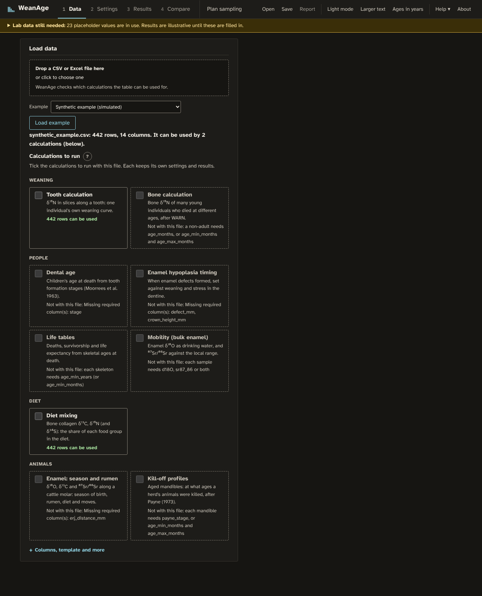

# WeanAge user guide

A walk through one full session: opening the app, loading isotope data, running the curve
models, reading the weaning age, comparing groups and planning a sampling protocol. The
screenshots show the bundled synthetic example, not real measurements.

Tooth growth tables and several lab parameters are placeholders, marked `TBD-LAB`, so the
weaning ages are illustrative until those values are supplied (see
[LAB_DATA_TBD.md](LAB_DATA_TBD.md)).

Settings that most people leave alone are under *Advanced settings* in each box. A yellow
TBD-LAB badge on an *Advanced settings* line means a placeholder value is inside.

Contents:
0. [Open the app](#0-open-the-app)
1. [Take the tour](#1-take-the-tour)
2. [See what lab data is missing](#2-see-what-lab-data-is-still-missing)
3. [Load your data](#3-load-your-data)
4. [Choose curve models](#4-choose-the-curve-models)
5. [Set collagen quality limits](#5-set-the-collagen-quality-limits)
6. [Check the tooth age models](#6-check-the-tooth-age-models)
7. [Optional corrections, then run](#7-optional-corrections-then-run)
8. [Read a specimen's result](#8-read-a-specimens-result)
9. [Act on warnings](#9-act-on-the-warnings)
10. [Compare the models](#10-compare-the-models-for-one-specimen)
11. [Zoom and add δ¹³C](#11-zoom-in-and-add-δ13c)
12. [Compare sites and species](#12-compare-sites-and-species)
13. [Plan sampling](#13-plan-your-sampling-before-cutting-teeth)
14. [Save, report and export](#14-save-report-and-export)
15. [Dark, light and larger text](#15-dark-light-and-larger-text)

## 0. Open the app

There are two ways:

* Browser version: open the WeanAge web page; nothing to install. The first visit
  downloads the analysis engine (about 40 MB) and then works offline. Your data never
  leave your computer.
* Installed version: from the project folder, `pip install -e .` once, then `weanage`.
  This opens `http://127.0.0.1:8765/app/` in your browser.

Both work the same way.

## 1. Take the tour

On the first visit an eight-step tour points out each part of the screen. Press *Next*,
or *Skip tour*. The *Help* menu in the top bar restarts it and links to the PDF user guide. The numbered tabs (Data, Settings,
Results, Compare, Plan sampling) follow the order you will work in.

## 2. See what lab data is still missing

The yellow bar under the header counts the placeholder values in use. Click it to see each
one, what is needed and which file it lives in. Once a value is filled in and marked as
real, it leaves the list.

## 3. Load your data

First drop a CSV or Excel file on the dashed box (common spellings such as `δ15N (‰)`, `C:N`
or `Animal` are recognised). WeanAge checks the table against every calculation and lists them
below the box: those it can feed show how many rows they can use; the others say what is missing
(for example "Missing required column(s): stage"). Tick the calculations to run. One table can
feed several: tooth slices with δ¹³C and δ¹⁵N can go to both the tooth calculation and diet
mixing. Each ticked calculation keeps its own data, settings and results, and the buttons at the
top of the page (*Showing: …*) switch between them.

For the tooth calculation, one row per dentine slice. Required columns: `specimen_id`, `site`,
`species`, `tooth`, `position_mm` (cusp tip to the middle of the slice) and `d15N`. Other
columns (for example `sex` or `burial`) are kept, so Compare can group by them. Instead of a
file you can also:

* *Download blank template* to start a spreadsheet with the right columns,
* *Add samples by hand* with the form on the right, or
* choose an example from the list (every calculation has one; loading it ticks its
  calculation): the simulated dataset, real archaeological cattle from Khami
  (Zimbabwe) and Bornais (Outer Hebrides) from the IsoArcH database, or human first molars
  from Mikulčice (CIMA). In the IsoArcH example the slice positions are assumed (see
  `src/weanage/data/examples/README.md`).

The *Tooth terms and how positions are measured* link in the instructions opens a labelled tooth diagram ("Tooth Section" by Sam Fentress,
Wikimedia Commons, CC BY-SA 2.0) with every term the app uses.

Data exported from [IsoArcH](https://isoarch.eu) can be converted with
`weanage isoarch export.xlsx --site <name> -o file.csv`.

The specimen table then lists each tooth and the age model it will use. Problems such as a
missing value are listed row by row. Teeth sharing an animal ID (here SYN-M1 and SYN-M2)
are joined into one timeline.

### Humans

Write `human` in the species column. Human first molars use a
growth table running from birth at the cusp apex to root completion at about 9.5 years (Beaumont et
al. 2013, London Atlas); it is marked TBD-LAB until it has been checked against the Atlas. In the
bone calculation, humans use WARN's own turnover values and priors.

### Months or years

*Ages in years* in the header switches results, charts, tables and the report from months
to years. The age boxes in the bone form and the bone planner are typed in the chosen unit.
Other inputs (growth tables, the tooth planner and the maximum weaning age) are always in
months and are labelled so. The analysis itself works in months.

### Bone instead of teeth

Tick *Bone calculation* under the drop zone when you have bone collagen from
many young animals of known or estimated age at death, rather than slices of teeth. One row
per animal: `specimen_id`, `site`, `species`, `d15N`, and for young animals the age at death
in months (`age_months`, or better `age_min_months` + `age_max_months`). Mark adults with
`age_class` = adult and the mothers with `sex` = F. Examples: a synthetic dataset, and human
bone from Wharram Percy, York Fishergate House and Newark Bay (CIMA). Settings then shows the bone model's
priors and turnover rates, and Results plots δ¹⁵N against age at death with the fitted bone
curve, the diet it implies and the estimated start and end of weaning. The method follows
WARN (Tsutaya & Yoneda 2013); see section 10 of [METHODS.md](METHODS.md). Livestock bone
turnover rates are still placeholders, so the ages are illustrative.

Animals can also be typed in one at a time under *Add animals by hand*: choose young, adult
female or adult male, give the age range at death for the young, and δ¹⁵N.

In bone mode, *Plan sampling* simulates sites with a known end of
suckling, samples them as your study would and runs the bone calculation on each. Compare, for
example, 20, 40 and 80 young animals to see how wide the 95% interval becomes and how often the
nursing signal is found.

### Season of birth, rumen development and diet (enamel)

Tick *Enamel: season and rumen* for sequential enamel samples from cattle molars. One row per
sample: `specimen_id`, `site`, `species`, `tooth`, `erj_distance_mm` (distance from the
enamel-root junction to the middle of the sample) and `d18O` and/or `d13C` (enamel carbonate,
‰ VPDB). A synthetic example of twelve M2 from two sites is included.

Results show, for each tooth, the **birth index** x₀/X: the position of the δ¹⁸O maximum as a share
of one year's crown growth. Compare it only between teeth of the same type: different values mean
different seasons of birth. Below it, δ¹³C is checked for a rise as the rumen develops, reported
with its position on the crown and a 95% interval. *Season of birth by group* shows each site's
indices and how many months births were spread over. *Diet* gives the share of C4 plants (millet,
maize, many tropical grasses) from the δ¹³C of the enamel formed after the rumen transition, with
a 95% interval. Set the plant values for the period in Settings: the defaults are pre-industrial;
modern animals need modern values. Compare and Plan sampling are not used in this mode. The method is in section 12 of [METHODS.md](METHODS.md).

Optional columns add more. `sr87_86` gives **Mobility**: where ⁸⁷Sr/⁸⁶Sr changes along the crown,
which suggests a move to other rocks; give a local range in Settings to flag values formed elsewhere.
The δ¹⁸O cycle places the rumen transition and any strontium shift in a **month** of the year (set the
month of the δ¹⁸O maximum in Settings; July by default). For birth and weaning months, enter a reference
tooth with a known birth month in Settings and give `weaning_age_months` for each animal, or run the
tooth calculation first: its weaning ages are used for teeth with the same specimen ID. *Enamel matures
over* (mm) undoes part of the smoothing of the δ¹⁸O cycle and the rumen step; leave it at 0 if unsure.

### Kill-off profiles

Tick *Kill-off profiles* for aged mandibles. One row per mandible: `specimen_id`, `site`, `species`
and either `payne_stage` (A–I, or two stages such as `D/E`, for sheep and goats) or `age_min_months`
and `age_max_months`. Results show survivorship by group, the share killed before 6 months, at 6–36
months and the share alive at 4 years (each with a 95% interval), the share killed in each age class,
and a permutation test between groups. A synthetic sheep/goat example is included. See section 13 of
[METHODS.md](METHODS.md).

### Diet mixing

Tick *Diet mixing* for bone (or dentine) collagen: `specimen_id`, `site`, `species`, `d13C`, `d15N`
and, if measured, `d34S`. In Settings, edit the food groups (2–6, each with a mean and SD per isotope)
and the collagen-diet offsets. The bundled values are placeholders: replace them with plants and
animals from the same site and period. Results show a δ¹³C–δ¹⁵N plot with the food groups, each group's
mean diet, and each sample's shares with 95% intervals. With more food groups than isotopes + 1, read
the intervals rather than the means. See section 14 of [METHODS.md](METHODS.md).

### Dental age

Tick *Dental age* for children's teeth scored in Moorrees et al. (1963) formation stages: one row
per tooth, with `specimen_id` (the individual), `site`, `species`, `tooth` (di1–dm2, I1–M3; P3/P4
are read as PM1/PM2) and `stage` (Ci … Ac, or 1–13). Results give each child's age at death with
the range passed on, and two buttons set these as the ages at death of the same specimen IDs in the
bone calculation or the life tables. The formation ages are placeholders until a published standard
is entered in `data/dental_stages.json`. See section 16 of [METHODS.md](METHODS.md).

### Enamel hypoplasia timing

Tick *Enamel hypoplasia timing* for linear enamel hypoplasia: one row per defect, with `tooth`,
`defect_mm` (height above the cemento-enamel junction) and `crown_height_mm` (unworn). Each defect
is dated, and if the tooth calculation has been run for the same specimen IDs, set against that
individual's weaning interval and stress episodes. Section 17 of [METHODS.md](METHODS.md).

### Life tables

Tick *Life tables* for skeletal ages at death: `age_min_years` and `age_max_years` (blank for an
open-ended adult age such as 50+). Results give survivorship, life expectancy, the share of infants
and under-fives, the juvenility index and a full life table for each site, an optional Siler hazard
fit and a permutation test between sites. Section 18 of [METHODS.md](METHODS.md).

### Mobility (bulk enamel)

Tick *Mobility* for bulk enamel δ¹⁸O and/or ⁸⁷Sr/⁸⁶Sr. Carbonate δ¹⁸O (‰ VPDB, the default) or
phosphate (‰ VSMOW, `d18O_material` = phosphate) is converted to drinking water; mark local fauna or
plants measured for strontium with `role` = baseline. Give local ranges in Settings if known. Section
19 of [METHODS.md](METHODS.md).

### Breast-milk share

In the tooth calculation, enter the adult-female δ¹⁵N (and, if measured, δ¹³C) for the site under
Settings → Advanced. Results then show, below the curve, how much of the diet was breast milk at each
increment, and when it fell below half. An optional third weaning food can be given if δ¹³C is known.
Section 15 of [METHODS.md](METHODS.md).

### Stress and δ³⁴S in dentine

In the tooth calculation, Results also lists **stress episodes** (δ¹⁵N above the weaning curve while
δ¹³C falls below its expected level) and, if a `d34S` column is given, **δ³⁴S shifts**. Their
thresholds are under Settings → Advanced.

## 4. Choose the curve models

All five weaning-curve shapes are fitted, so you can see how much the choice of model
changes the answer. Each has its own colour and line pattern.

| model | use it when |
|---|---|
| Logistic | a smooth S-shaped decline (the usual default) |
| Piecewise linear | a straight drop between two flat levels |
| Exponential | the drop starts abruptly and then slows |
| Two-phase | supplementary feeding came before final weaning (e.g. dairying) |
| Elbow (WEAN) | results comparable with WEAN (Ganiatsou et al. 2023) |

A curve can be fitted to any series, even a flat one, so a model shows no weaning age when
δ¹⁵N falls by less than the minimum drop (1‰ by default) or the fall is centred before
birth. The elbow model also shows none when its estimate spans most of the series. The
message says which.

Below the models, choose the milestone to report, how uncertainty is calculated, and the
smallest and largest believable δ¹⁵N drop. The default milestone is the midpoint (half the
fall), which is dated most precisely. Completion (95% of the fall) depends on how slowly
δ¹⁵N levels off and is often much later than the end of suckling.

## 5. Set the collagen quality limits

Samples outside these limits are flagged and, by default, not fitted. Start from a
published set: *Archaeological* (C:N 2.9–3.6) for archaeological teeth, or *Modern
reference animals* (C:N 3.00–3.28, Guiry & Szpak 2020) for modern known-age animals.

## 6. Check the tooth age models

An age model turns a slice's position into the animal's age when that dentine formed.
Edit the points, switch to a simple linear model, or *Calibrate from reference data*
from known-age animals. *Save to my tables* keeps your version. Ages here are in months.
The age uncertainty is carried into every interval, so set it realistically.

## 7. Optional corrections, then run

* Time averaging: each slice mixes weeks of growth, which blurs and delays the
  weaning signal (Tsutaya 2020). With this on, the curve describes the real diet change.
* Seasonal term: a yearly cycle, so a seasonal pasture change is not taken for weaning.
* Adult-female baselines: δ¹⁵N of adult females from the same site, for nursing enrichment.

Press *Run analysis* at the bottom of Settings. A progress bar follows each specimen.

## 8. Read a specimen's result

The Results tab lists each specimen with its weaning age; *!* marks warnings. Click one,
or use the ↑ ↓ keys.

Dots are the measured slices (the hollow red dot failed QC). Each curve is one model;
dashed lines mark the estimated weaning ages, and 95% intervals are drawn as bars above
the age axis. The top axis shows where on the tooth each age lies.

An age later than the last sample is shown as "after X months" (or "before X months" for
one earlier than the first sample), with no interval and no marker, because the curve
beyond the samples is not measured. Such ages are left out of group comparisons.

## 9. Act on the warnings

Warnings explain anything that could make an estimate unreliable, and name the research
behind them.

| warning | what to do |
|---|---|
| Age after the last sample | the tooth ends before weaning did; report it as a lower bound or add a later-forming tooth |
| Drop larger than one food-chain step | another diet change, mixed-up samples or a bad fit (DeNiro & Epstein 1981; Minagawa & Wada 1984) |
| δ¹⁵N rises with age | consider stress or illness (Beaumont & Montgomery 2016) |
| δ¹³C falls across weaning (cattle) | known-age calves showed a rise (Balasse et al. 2001); check the interpretation |
| Annual cycle | turn on the seasonal term and run again |

## 10. Compare the models for one specimen

The table gives every milestone with its 95 % interval, the nursing and adult δ¹⁵N, the
drop, and each model's support (ΔAICc and weight). Click any *?* for a plain-language
explanation.

## 11. Zoom in and add δ13C

Drag across the chart to zoom; double-click or *Reset zoom* to go back. *Show δ¹³C*
adds the carbon values on a second axis.

## 12. Compare sites and species

Group by site, species and/or period, or by any other column of the tooth table that varies (for example `sex` or `burial`), and choose where the estimates come from.

"Are the differences real?" starts with a one-sentence answer, then the formal tests.

Under *Bayesian model*, choose *One-stage* to fit every tooth's raw δ¹⁵N values together
with the group means. This carries each curve's shape and age-model uncertainty all the way
through. It takes a little longer, and teeth whose weaning age would be an extrapolation are
left out and listed.

Files with `known_weaning_age_months` also get a validation table (or run
`weanage validate reference.csv`; see [VALIDATION.md](VALIDATION.md)).

## 13. Plan your sampling before cutting teeth

The planner invents teeth with known weaning ages, samples them as your protocol would, and
scores each model on the completion age. Choose the shape of the true curves: a random mix
avoids favouring the logistic model. Then vary one setting, such as the sampling interval.
An estimate beyond the simulated tooth counts as not dated.

## 14. Save, report and export

* *Save* writes the whole project to one file; *Open* loads it. Work is also kept in
  the browser automatically.
* *Report* downloads a web page with every setting, chart, table, warning and reference;
  print it to PDF. Reports always use light colours.
* Under the model table: estimates (CSV), full results (JSON) and the chart (SVG).

## 15. Dark, light and larger text

WeanAge opens in a high-contrast dark theme. *Light mode* and *Larger text* in the
header change it, and the choice is remembered. All text meets WCAG AAA contrast.

