# WeanAge user guide

A walk through one full session: opening the app, loading isotope data, running the curve
models, reading the weaning age, comparing groups and planning a sampling protocol. The
screenshots show the bundled **synthetic** example, not real measurements.

> **Draft status.** Tooth growth tables and several lab parameters are still placeholders,
> marked `TBD-LAB`. The app works end to end, but the weaning ages are illustrative until
> those values come from lab work.

**Contents:**
0. [Open the app](#0-open-the-app)
1. [Take the tour](#1-take-the-tour)
2. [See what lab data is missing](#2-see-what-lab-data-is-still-missing)
3. [Load your data](#3-load-your-data)
4. [Choose curve models](#4-choose-the-curve-models)
5. [Set collagen quality limits](#5-set-the-collagen-quality-limits)
6. [Check the tooth age models](#6-check-the-tooth-age-models)
7. [Optional corrections, then run](#7-optional-corrections-then-run)
8. [Read a specimen's result](#8-read-a-specimens-result)
9. [Act on warnings](#9-act-on-the-warnings)
10. [Compare the models](#10-compare-the-models-for-one-specimen)
11. [Zoom and add δ¹³C](#11-zoom-in-and-add-δ13c)
12. [Compare sites and species](#12-compare-sites-and-species)
13. [Plan sampling](#13-plan-your-sampling-before-cutting-teeth)
14. [Save, report and export](#14-save-report-and-export)
15. [Dark, light and larger text](#15-dark-light-and-larger-text)

## 0. Open the app

There are two ways:

* **Browser version**: open the WeanAge web page; nothing to install. The first visit
  downloads the analysis engine (about 40 MB) and then works offline. Your data never
  leaves your computer.
* **Installed version**: from the project folder, `pip install -e .` once, then `weanage`.
  This opens `http://127.0.0.1:8765/app/` in your browser.

Both look and work the same.

## 1. Take the tour

On the first visit an eight-step tour points out each part of the screen. Press **Next**,
or **Skip tour**; **Help** in the top bar restarts it. The numbered tabs (Data, Settings,
Results, Compare, Plan sampling) follow the order you will work in.

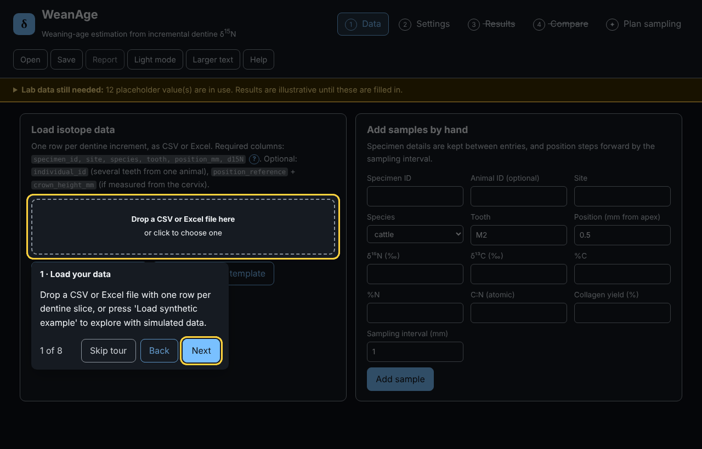

## 2. See what lab data is still missing

The yellow bar under the header counts the placeholder values in use. Click it to see each
one, what is needed and which file it lives in. Once a value is filled in and marked as
real, it leaves the list.

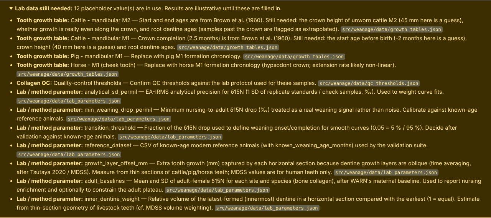

## 3. Load your data

One row per dentine slice. Required columns: `specimen_id`, `site`, `species`, `tooth`,
`position_mm` (cusp tip to the middle of the slice) and `d15N`. Either:

* drop a **CSV or Excel** file on the dashed box (common spellings such as `δ15N (‰)`,
  `C:N` or `Animal` are recognised),
* **Download blank template** to start a spreadsheet with the right columns, or
* **Add samples by hand** with the form on the right, or
* choose an **example**: the simulated dataset, or real archaeological cattle from Khami
  (Zimbabwe) and Bornais (Outer Hebrides) taken from the IsoArcH database. In the real
  example the slice positions are assumed (see `src/weanage/data/examples/README.md`).

Not sure what *cusp apex*, *cervix* or `position_mm` mean? The **Tooth terms and how positions are
measured** link in the instructions opens a labelled tooth diagram ("Tooth Section" by Sam Fentress,
Wikimedia Commons, CC BY-SA 2.0) with every term the app uses.

Data exported from [IsoArcH](https://isoarch.eu) can be converted with
`weanage isoarch export.xlsx --site <name> -o file.csv`.

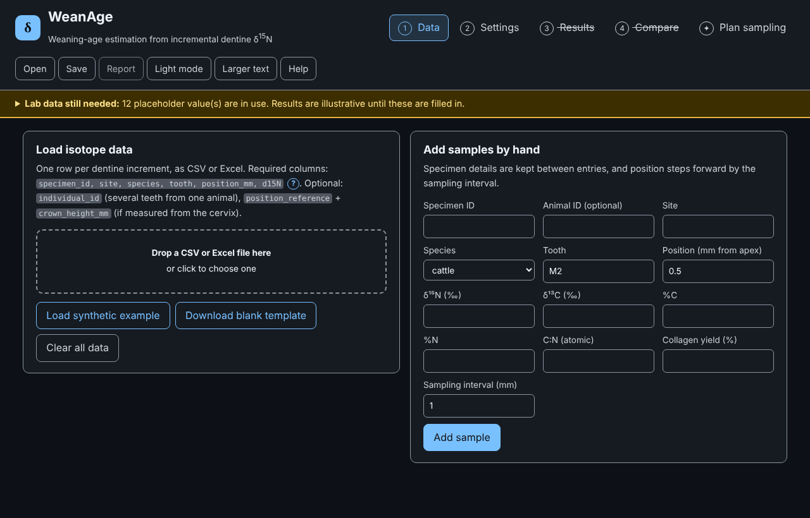

The specimen table then lists each tooth and the age model it will use. Problems such as a
missing value are listed row by row. Teeth sharing an animal ID (here SYN-M1 and SYN-M2)
are joined into one timeline.

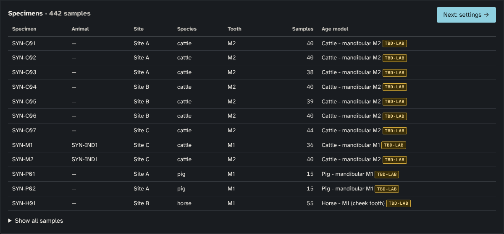

## 4. Choose the curve models

All five weaning-curve shapes are fitted, so you can see how much the choice of method
changes the answer. Each has its own colour *and* line pattern.

| model | use it when |
|---|---|
| Logistic | a smooth S-shaped decline (the usual default) |
| Piecewise linear | a straight drop between two flat levels |
| Exponential | the drop starts abruptly and then slows |
| Two-phase | supplementary feeding came before final weaning (e.g. dairying) |
| Elbow (WEAN) | results comparable with WEAN (Ganiatsou et al. 2023) |

Below them choose the milestone to report (onset, midpoint or completion), how
uncertainty is calculated, and the smallest and largest believable δ¹⁵N drop.

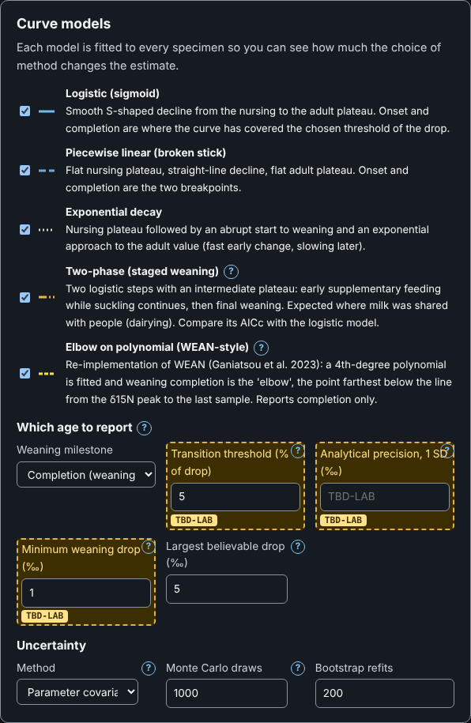

## 5. Set the collagen quality limits

Samples outside these limits are flagged and, by default, not fitted. Start from a
published set: **Archaeological** (C:N 2.9–3.6) for archaeological teeth, or **Modern
reference animals** (C:N 3.00–3.28, Guiry & Szpak 2020) for modern known-age animals.

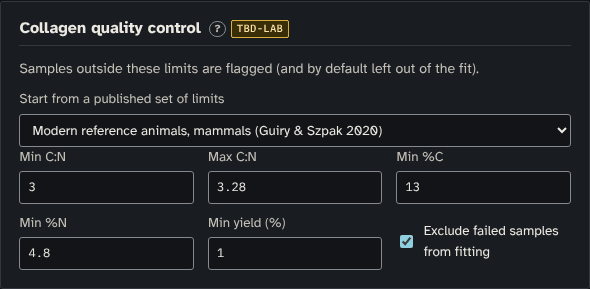

## 6. Check the tooth age models

An age model turns a slice's position into the animal's age when that dentine formed.
Edit the points, switch to a simple linear model, or **Calibrate from reference data**
from known-age animals. **Save to my tables** keeps your version. Set the **age
uncertainty** honestly: it is carried into every interval.

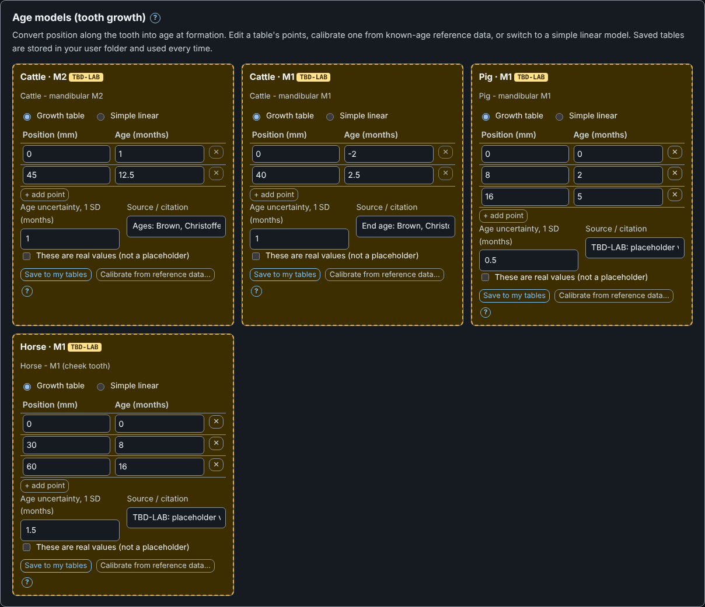

## 7. Optional corrections, then run

* **Time averaging**: each slice mixes weeks of growth, which blurs and delays the
  weaning signal (Tsutaya 2020). With this on, the curve describes the real diet change.
* **Seasonal term**: a yearly cycle, so a seasonal pasture change is not taken for weaning.
* **Adult-female baselines**: δ¹⁵N of adult females from the same site, for nursing enrichment.

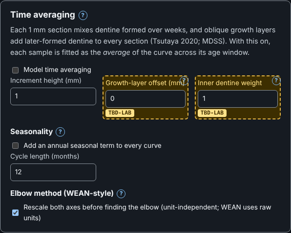

Press **Run analysis** at the bottom of Settings. A progress bar follows each specimen.

## 8. Read a specimen's result

The Results tab lists each specimen with its weaning age; **!** marks warnings. Click one,
or use the ↑ ↓ keys.

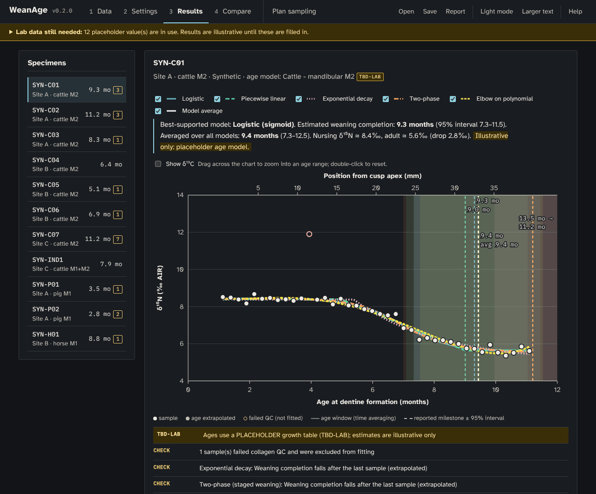

Dots are the measured slices (the hollow red dot failed QC). Each curve is one model;
dashed lines mark the estimated weaning ages, with shaded 95 % intervals. The top axis
shows where on the tooth each age lies.

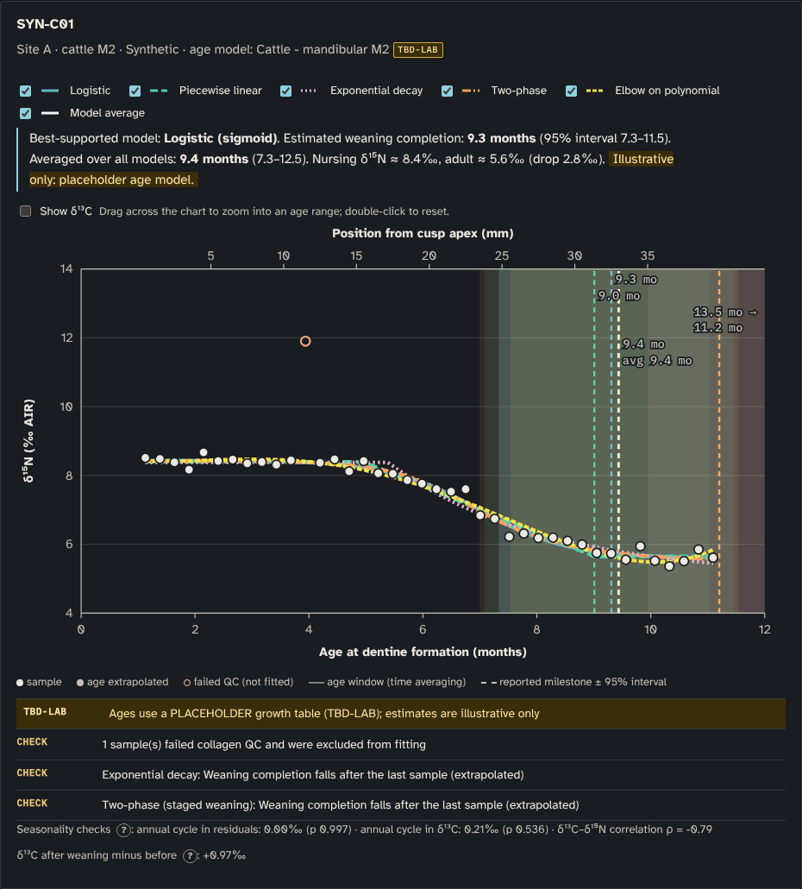

## 9. Act on the warnings

Warnings explain anything that could make an estimate unreliable, and name the research
behind them.

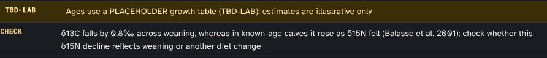

| warning | what to do |
|---|---|
| Completion falls after the last sample | the tooth ends before weaning did; treat as an extrapolation or add a later-forming tooth |
| Drop larger than one food-chain step | another diet change, mixed-up samples or a bad fit (DeNiro & Epstein 1981; Minagawa & Wada 1984) |
| δ¹⁵N rises with age | consider stress or illness (Beaumont & Montgomery 2016) |
| δ¹³C falls across weaning (cattle) | known-age calves showed a rise (Balasse et al. 2001); check the interpretation |
| Annual cycle | turn on the seasonal term and run again |

## 10. Compare the models for one specimen

The table gives every milestone with its 95 % interval, the nursing and adult δ¹⁵N, the
drop, and each model's support (ΔAICc and weight). Click any **?** for a plain-language
explanation.

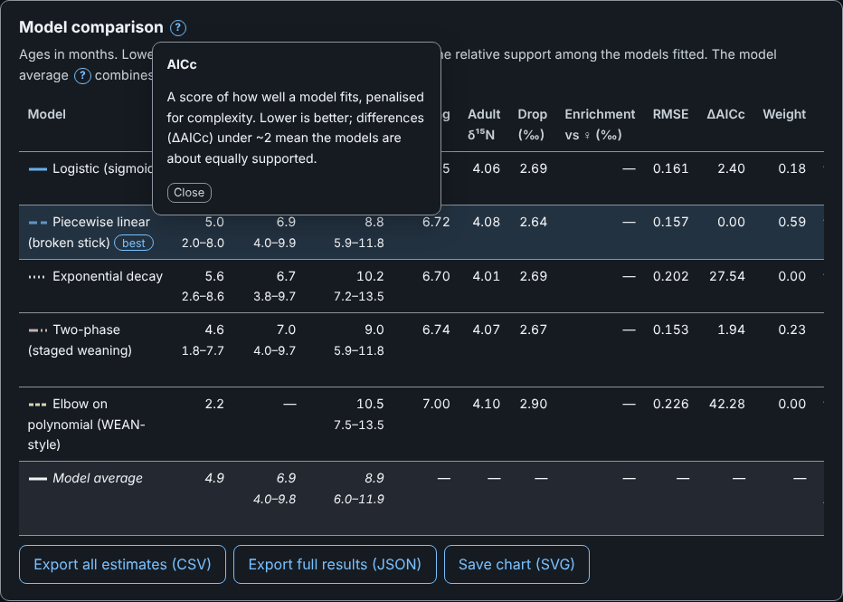

## 11. Zoom in and add δ13C

Drag across the chart to zoom; double-click or **Reset zoom** to go back. **Show δ¹³C**
adds the carbon values on a second axis.

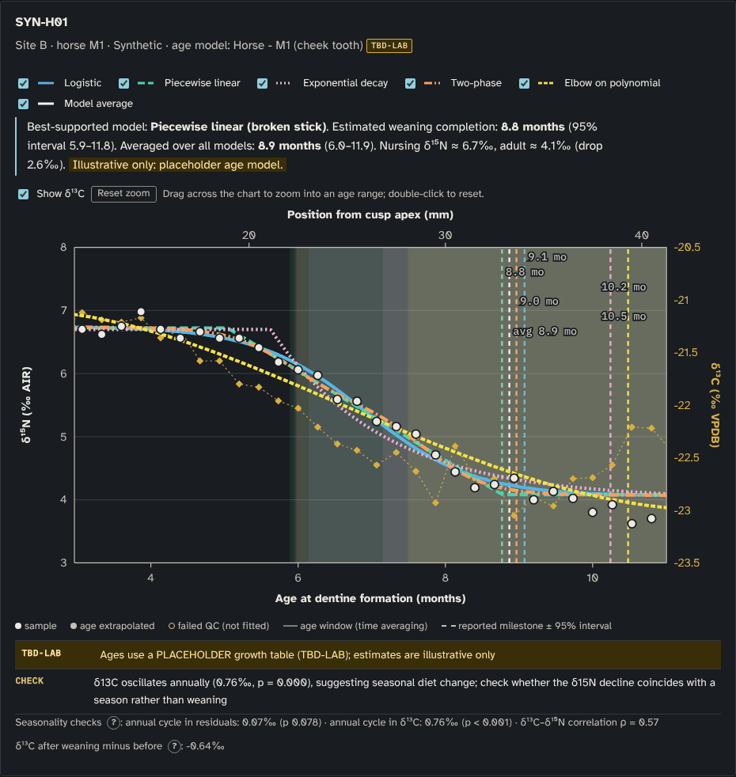

## 12. Compare sites and species

Group by site, species and/or period, and choose where the estimates come from.

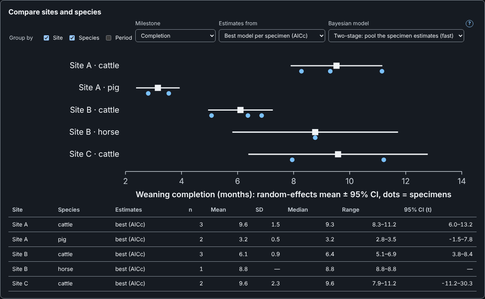

"Are the differences real?" starts with a one-sentence answer, then the formal tests.

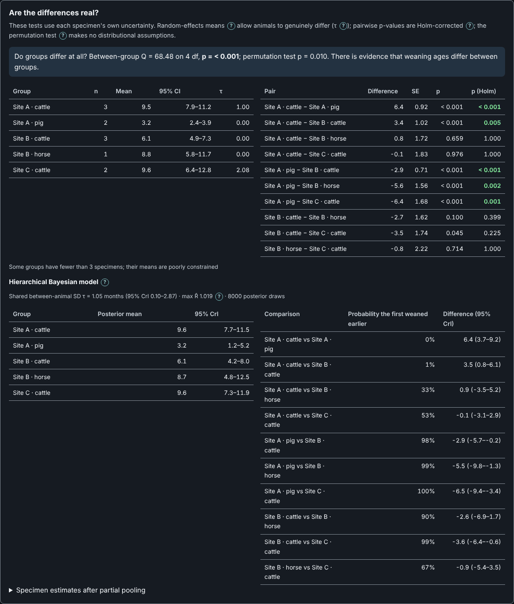

Under **Bayesian model**, choose **One-stage** to fit every tooth's raw δ¹⁵N values together
with the group means. This carries each curve's shape and age-model uncertainty all the way
through. It takes a little longer, and teeth whose weaning age would be an extrapolation are
left out and listed.

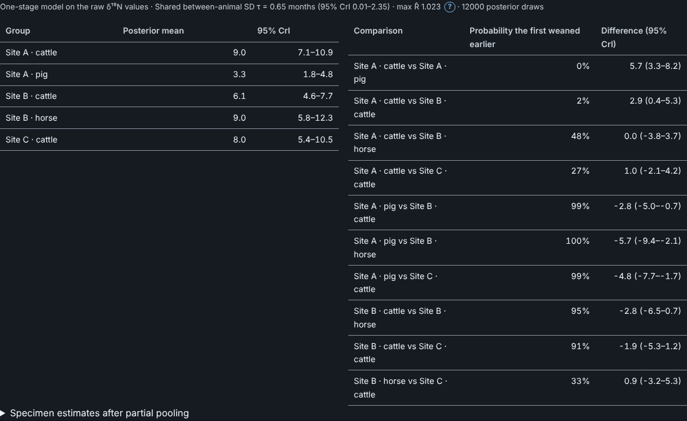

Files with `known_weaning_age_months` also get a **validation** table (or run
`weanage validate reference.csv`; see [VALIDATION.md](VALIDATION.md)).

## 13. Plan your sampling before cutting teeth

The planner invents teeth with known weaning ages, samples them as your protocol would, and
scores each model. Choose the **shape of the true curves**: a random mix avoids favouring
the logistic model. Then vary one setting, such as the sampling interval.

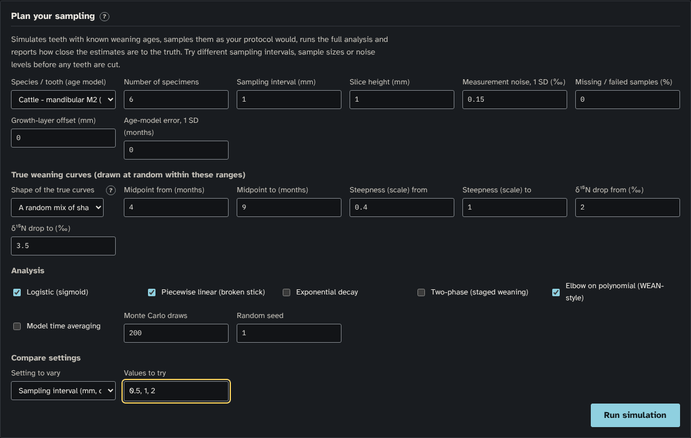

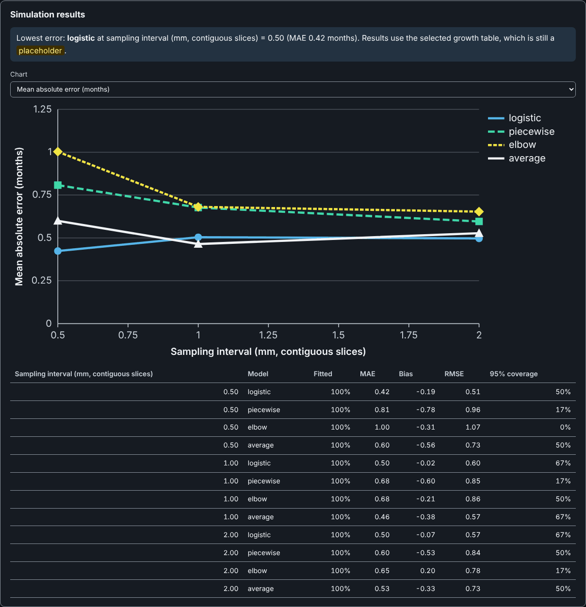

## 14. Save, report and export

* **Save** writes the whole project to one file; **Open** loads it. Work is also kept in
  the browser automatically.
* **Report** downloads a web page with every setting, chart, table, warning and reference;
  print it to PDF. Reports always use light colours.
* Under the model table: estimates (CSV), full results (JSON) and the chart (SVG).

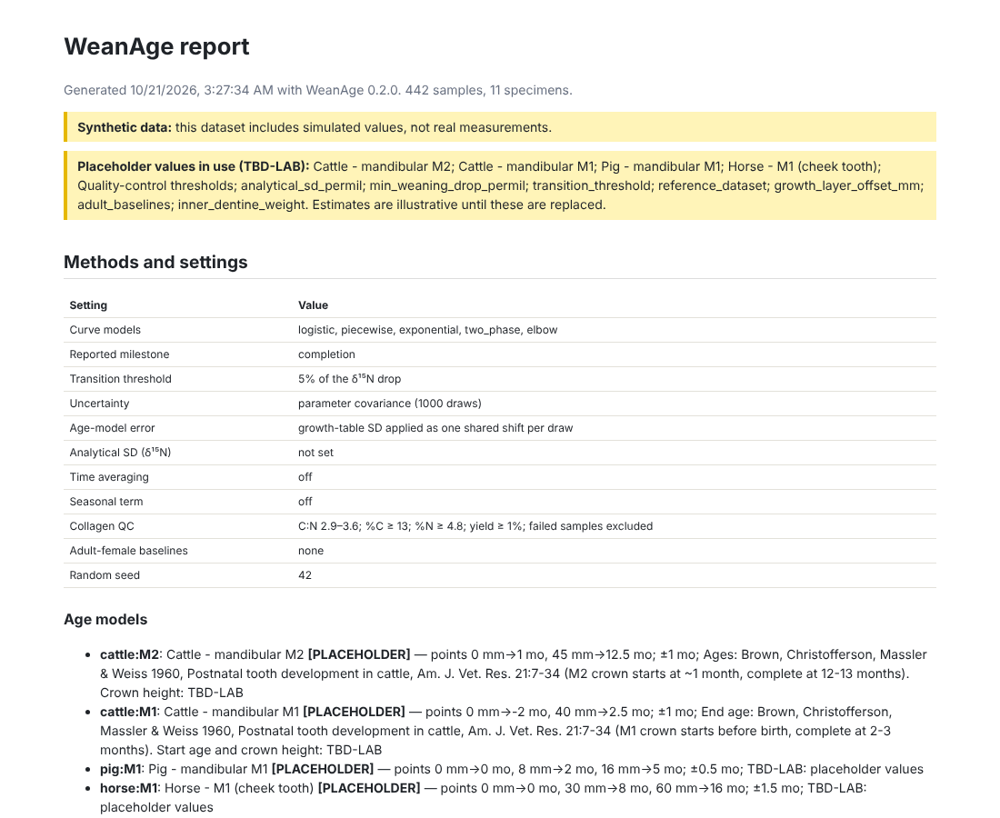

## 15. Dark, light and larger text

WeanAge opens in a high-contrast dark theme. **Light mode** and **Larger text** in the
header change it, and the choice is remembered. All text meets WCAG AAA contrast.

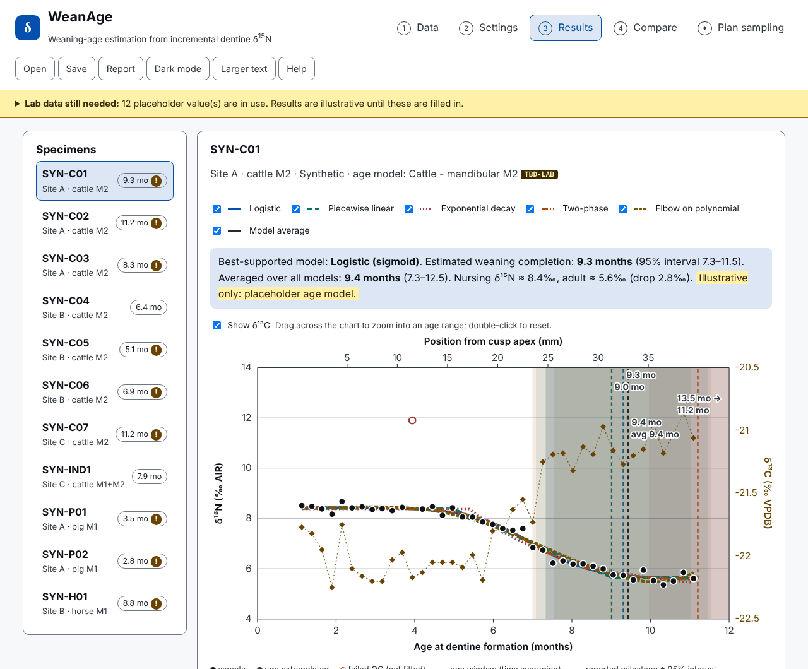
