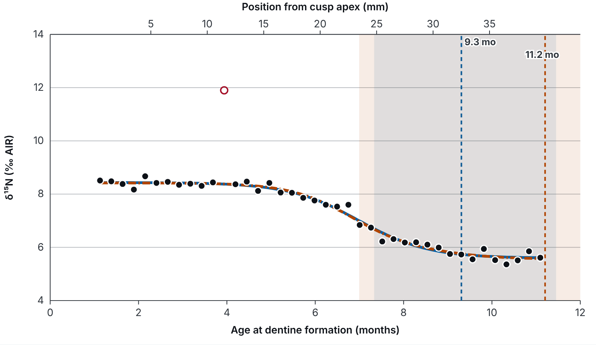

**What it is.** WeanAge turns a series of δ¹⁵N values measured along a tooth into a weaning
age with an honest uncertainty, for cattle, pigs and horses (and any species with a tooth
growth table). It compares several curve models, corrects for the blurring caused by
slicing, compares sites and species, and helps plan sampling before any tooth is cut. It
runs in a web browser with nothing to install, or as a local app and command line.

**Why it matters.** When animals were weaned shows how herds were managed. Early weaning
frees milk for people, staged weaning points to dairying, and the timing reflects seasonal
births (Balasse & Tresset 2002; Balasse et al. 2021). Tools so far were built for humans
(WARN: Tsutaya & Yoneda 2013; WEAN: Ganiatsou et al. 2023), so each livestock study has
written its own model, and the results are hard to compare. WeanAge aims to be one
documented, tested method that any lab can use.

## The principle

A suckling animal feeds one step up the food chain from its mother, so its tissues carry
about 3–4‰ more ¹⁵N (DeNiro & Epstein 1981; Minagawa & Wada 1984). After weaning, δ¹⁵N
falls to the adult level. Dentine grows in layers and is not remodelled, so thin slices
cut along a tooth record this fall month by month (Balasse et al. 2001; Beaumont et al. 2013).

<figure>

<figcaption>A synthetic cattle M2 in WeanAge. Dots are dentine slices (the hollow point failed
collagen QC and is not fitted). Two of the five models are shown: logistic (blue, solid)
and two-phase (orange, dash-dot). Dashed vertical lines mark each model's weaning
completion with its shaded 95 % interval; the top axis gives the position on the tooth.
The two-phase completion falls after the last slice, so the app flags it as an
extrapolation: the logistic estimate (9.3 months) is the better supported one here.</figcaption>
</figure>

## Methods, and why they are built this way

| Step | What WeanAge does | Why | Based on |
|---|---|---|---|
| Position → age | Converts each slice's distance from the cusp to an age at formation, using a growth table for the species and tooth, or a calibration from known-age teeth. Teeth of one animal are joined into one timeline. | Weaning is an age, but the lab measures millimetres. Errors in the growth table move every slice of a tooth together, so they are added as one shared shift. | Cattle crown chronology: Brown et al. 1960 |
| Collagen quality | Flags slices by C:N, %C, %N and yield; archaeological and modern presets. | Degraded or contaminated collagen gives false δ¹⁵N values. Modern collagen needs a tighter C:N window. | DeNiro 1985; van Klinken 1999; Guiry & Szpak 2020 |
| Five curve models | Logistic, piecewise linear, exponential, two-phase (staged weaning) and a WEAN-style polynomial "elbow". | The shape of weaning is not known in advance, and the chosen shape changes the age. Fitting all of them shows how much the answer depends on the choice. Two-phase captures supplementary feeding before final weaning. | Tsutaya & Yoneda 2013; Ganiatsou et al. 2023 |
| Model comparison | AICc, Akaike weights, and a model-averaged weaning age. | AICc balances fit against complexity in small samples; averaging avoids betting on one model. | Hurvich & Tsai 1989; Burnham & Anderson 2002 |
| Uncertainty | 95 % intervals from the fit's covariance or a residual bootstrap, plus the age-model error. | Every weaning age should come with how sure we can be. | Efron & Tibshirani 1993 |
| Slice blurring | Optionally fits each slice as the average of the curve over its height and the dentine depth, with oblique growth layers and less volume towards the pulp. | Each slice mixes weeks of growth, which smooths and delays the signal. Modelling the mixing recovers the real diet change. | Tsutaya 2020 (MDSS) |
| Plausibility checks | Warns when the drop is below the noise or above one food-chain step; when δ¹⁵N rises with age; when there is a yearly cycle; and when δ¹³C falls across weaning in cattle. | Each points to something other than weaning: noise, stress, seasonal diet or mixed samples. In known-age calves δ¹³C rose as δ¹⁵N fell. | Fuller et al. 2006; Beaumont & Montgomery 2016; Balasse et al. 2001, 2021 |
| Comparing groups | Random-effects means, permutation and Holm-corrected tests, and hierarchical Bayesian models: two-stage (pooling the estimates) or one-stage (fitting every tooth's raw values together). | Animals genuinely differ, and each estimate has its own uncertainty. Bayesian models give direct answers such as "probability pigs were weaned earlier than cattle". The one-stage model carries each curve's uncertainty all the way through. | DerSimonian & Laird 1986; Holm 1979; Gelman 2006; Vehtari et al. 2021 |
| Validation | Bias, error, correlation and interval coverage against known-age animals or published estimates. | A method is only as good as its record on animals whose weaning age is known. | Balasse et al. 2001; Ganiatsou et al. 2023 |
| Sampling planner | Simulates teeth with known weaning (of several curve shapes), samples them as a protocol would, and scores each model. | Shows the slice size, number of teeth and precision needed before material is destroyed. | — |

## Design principles

* **Transparent about what is not yet known.** Every value still awaiting lab work
  (growth tables, layer geometry, precision) is marked `TBD-LAB` and highlighted in the app
  and in each result, so placeholder results cannot pass as real.
* **Reproducible.** Projects save to one file. Reports record every setting and source,
  and known-answer tests keep results stable between versions.
* **Accessible.** Plain-language help for every term, a high-contrast dark theme with a
  light mode (WCAG AAA text), colour-blind-safe curves with distinct line patterns, and
  full keyboard use.
* **Nothing to install.** The browser version runs the same Python code inside the page
  (Pyodide). Data never leaves the computer, and it works offline after the first visit.

## Status and how to take part

WeanAge is a working draft. The method runs end to end, but **the tooth growth tables and several lab parameters are placeholders**, so
results are illustrative until they are measured. Contributions that would help most:

* known-age reference animals (dentine δ¹⁵N series with recorded weaning dates),
* tooth growth data for pigs and horses, and crown heights for cattle,
* testing on published series, and feedback on the interface.

**Code, guide and documentation:** <https://github.com/andymaehartley/repotest>

**Cite:** Hartley, A. WeanAge: weaning-age estimation from incremental dentine δ¹⁵N
(version 0.2). See `CITATION.cff` in the repository.

## References

Balasse, M., Bocherens, H., Mariotti, A. & Ambrose, S. H. (2001). Detection of dietary changes by intra-tooth carbon and nitrogen isotopic analysis: an experimental study of dentine collagen of cattle (*Bos taurus*). *Journal of Archaeological Science* 28, 235–245.

Balasse, M. & Tresset, A. (2002). Early weaning of Neolithic domestic cattle (Bercy, France) revealed by intra-tooth variation in nitrogen isotope ratios. *Journal of Archaeological Science* 29, 853–859.

Balasse, M. et al. (2021). Seasonal calving in European Prehistoric cattle and its impacts on milk availability and cheese-making. *Scientific Reports* 11, 8185.

Beaumont, J., Gledhill, A., Lee-Thorp, J. & Montgomery, J. (2013). Childhood diet: a closer examination of the evidence from dental tissues using stable isotope analysis of incremental human dentine. *Archaeometry* 55, 277–295.

Beaumont, J. & Montgomery, J. (2016). The Great Irish Famine: identifying starvation in the tissues of victims using stable isotope analysis of bone and incremental dentine collagen. *PLoS ONE* 11, e0160065.

Brown, W. A. B., Christofferson, P. V., Massler, M. & Weiss, M. B. (1960). Postnatal tooth development in cattle. *American Journal of Veterinary Research* 21, 7–34.

Burnham, K. P. & Anderson, D. R. (2002). *Model Selection and Multimodel Inference* (2nd ed.). Springer.

DeNiro, M. J. (1985). Postmortem preservation and alteration of in vivo bone collagen isotope ratios in relation to palaeodietary reconstruction. *Nature* 317, 806–809.

DeNiro, M. J. & Epstein, S. (1981). Influence of diet on the distribution of nitrogen isotopes in animals. *Geochimica et Cosmochimica Acta* 45, 341–351.

DerSimonian, R. & Laird, N. (1986). Meta-analysis in clinical trials. *Controlled Clinical Trials* 7, 177–188.

Efron, B. & Tibshirani, R. J. (1993). *An Introduction to the Bootstrap*. Chapman & Hall.

Fuller, B. T., Fuller, J. L., Harris, D. A. & Hedges, R. E. M. (2006). Detection of breastfeeding and weaning in modern human infants with carbon and nitrogen stable isotope ratios. *American Journal of Physical Anthropology* 129, 279–293.

Ganiatsou, E., Souleles, A. & Papageorgopoulou, C. (2023). WEaning Age FiNder (WEAN): a tool for estimating weaning age from stable isotope ratios of dentinal collagen. *Archaeological and Anthropological Sciences* 15, 50.

Gelman, A. (2006). Prior distributions for variance parameters in hierarchical models. *Bayesian Analysis* 1, 515–534.

Guiry, E. J. & Szpak, P. (2020). Quality control for modern bone collagen stable carbon and nitrogen isotope measurements. *Methods in Ecology and Evolution* 11, 1049–1060.

Holm, S. (1979). A simple sequentially rejective multiple test procedure. *Scandinavian Journal of Statistics* 6, 65–70.

Hurvich, C. M. & Tsai, C.-L. (1989). Regression and time series model selection in small samples. *Biometrika* 76, 297–307.

Minagawa, M. & Wada, E. (1984). Stepwise enrichment of ¹⁵N along food chains: further evidence and the relation between δ¹⁵N and animal age. *Geochimica et Cosmochimica Acta* 48, 1135–1140.

Tsutaya, T. (2020). Blurred time resolution of tooth dentin serial sections. *American Journal of Physical Anthropology* 173, 748–759.

Tsutaya, T. & Yoneda, M. (2013). Quantitative reconstruction of weaning ages in archaeological human populations using bone collagen nitrogen isotope ratios and approximate Bayesian computation. *PLoS ONE* 8, e72327.

van Klinken, G. J. (1999). Bone collagen quality indicators for palaeodietary and radiocarbon measurements. *Journal of Archaeological Science* 26, 687–695.

Vehtari, A., Gelman, A., Simpson, D., Carpenter, B. & Bürkner, P.-C. (2021). Rank-normalization, folding, and localization: an improved R̂ for assessing convergence of MCMC. *Bayesian Analysis* 16, 667–718.

