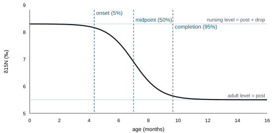
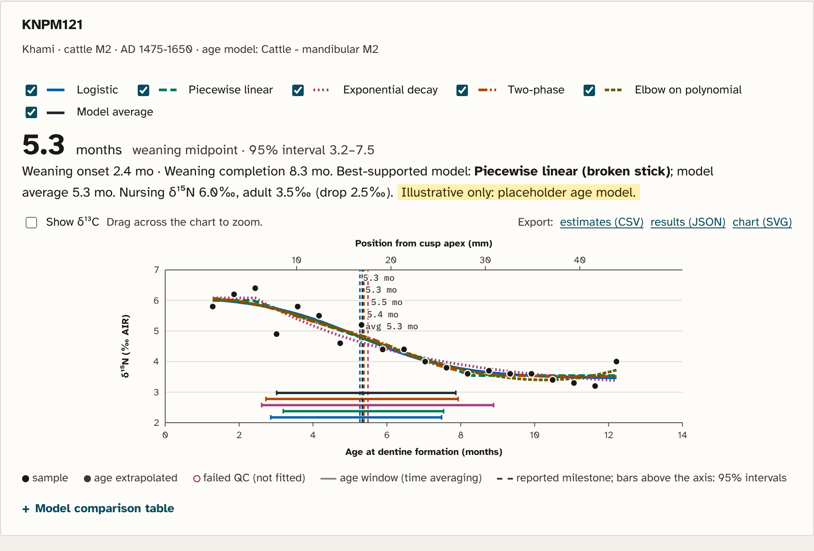
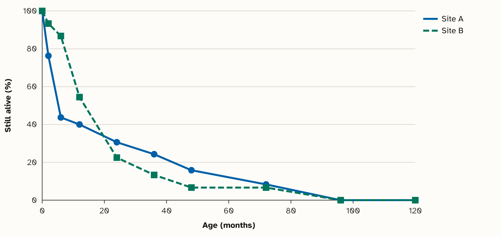
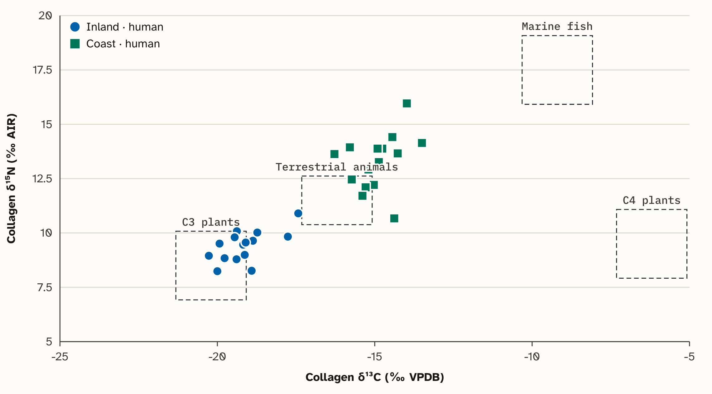
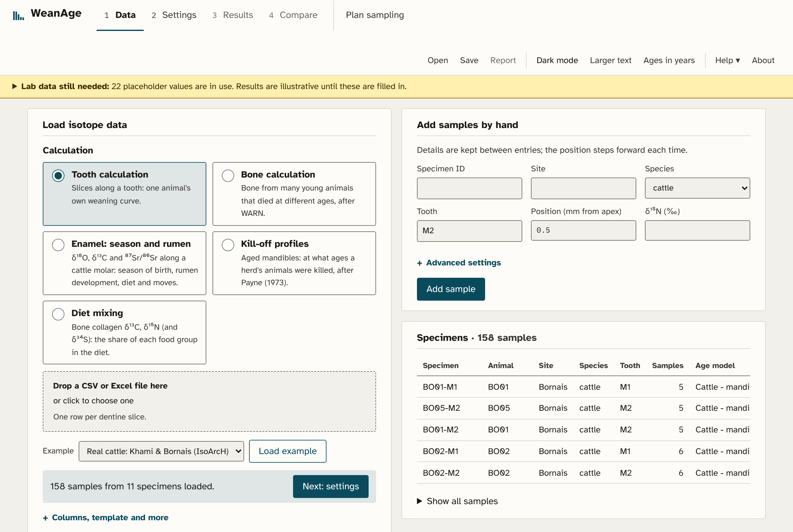
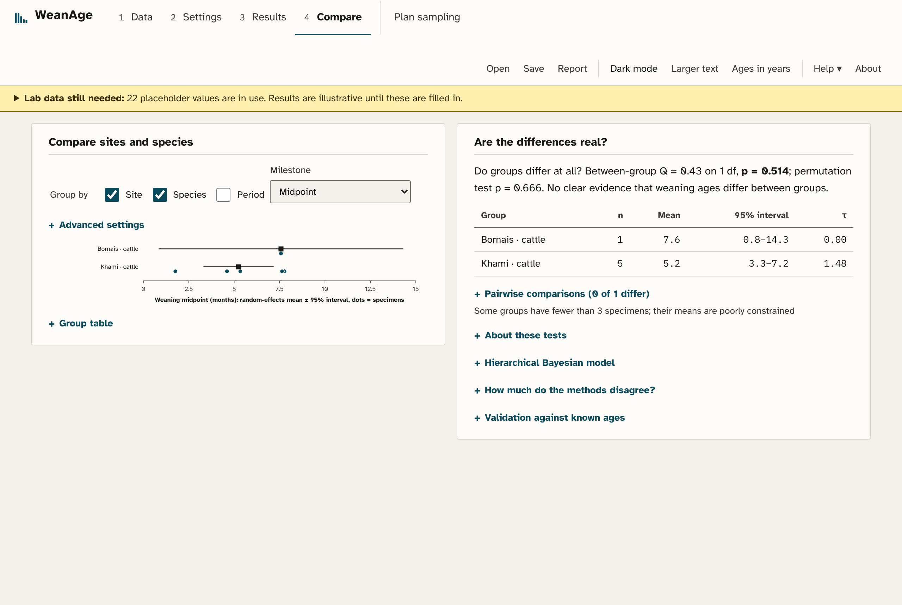

# About this guide

WeanAge estimates when young mammals were weaned from the nitrogen isotope ratio (δ¹⁵N) of
their collagen. It works with two kinds of material: thin slices along one tooth, which record
one animal's childhood, and the bones of many young animals from one site that died at
different ages. For cattle it also reads enamel δ¹⁸O, δ¹³C and ⁸⁷Sr/⁸⁶Sr along a molar for the
season of birth, the development of the rumen, the diet and moves. Two further calculations put
weaning in context: kill-off profiles from aged mandibles, and the make-up of the diet from bone
collagen. It runs as a local app or in a web browser.

This guide explains each part of the software, how the parts combine into a weaning age, and
where each method comes from. Section 1 gives the background, sections 2–10 follow the
calculations step by step, section 11 shows the app, and section 12 lists what is still provisional. Words in
`code font` are column names, settings or files in the software. References are listed at the end.

# 1. Background

## Why δ¹⁵N records weaning

δ¹⁵N rises by about 3–4‰ with each step up a food chain (DeNiro & Epstein 1981; Minagawa &
Wada 1984). A suckling animal feeds on its mother's tissues through her milk, so its own
collagen is raised above hers, usually by 2–3‰ in practice (Balasse et al. 2001; Fuller et al.
2006). When milk is replaced by solid food, new collagen gradually falls to the adult level.
The age at which that fall happens is the weaning age.

Collagen is the protein measured. Dentine collagen forms in layers as the tooth grows and is not
renewed afterwards, so a series of slices from crown tip to root is a timeline of one animal's
diet (Beaumont et al. 2013). Bone collagen, by contrast, is renewed throughout life, so a bone
records a mix of recent and older diet; a single bone cannot give a timeline, but many young
animals that died at different ages can (Tsutaya & Yoneda 2013).

## What "weaning age" means here

Weaning is a process, not an instant. WeanAge reports three milestones of the δ¹⁵N fall
(Figure 1): **onset** (5% of the fall has happened), **midpoint** (half of it) and
**completion** (95%). The midpoint is reported by default: the curve is steepest there, so it
is dated most precisely. Completion depends on how slowly δ¹⁵N levels off and can fall well
after suckling stopped. In known-age calves the δ¹⁵N fall traces the end of suckling (Balasse
et al. 2001), and the same has been found in sheep (Díez-Canseco & Tornero 2026).

{width=78%}

## The routes through the software

<b>Tooth calculation</b> slices of one tooth → position to age (§3) → quality control (§2) → curve models (§4) → uncertainty, averaging (§4) → one animal's weaning age

<b>Bone calculation</b> many young animals + adult females → quality control (§2) → diet and bone-turnover model (§5) → Bayesian fit (§5) → a site's weaning age

<b>Enamel (cattle)</b> δ¹⁸O, δ¹³C, ⁸⁷Sr/⁸⁶Sr up one molar → yearly δ¹⁸O cycle (§6) → season-of-birth index → rumen development, C4 share → moves, and months of the year (§6)

<b>Context</b> aged mandibles → kill-off profile (§7) bone collagen → diet make-up (§8)  <b>Then</b> compare groups (§9); plan sampling (§10)

The app has the same order: **Data → Settings → Results → Compare**, plus **Plan sampling**.
The Data tab switches between the tooth, bone, enamel, kill-off and diet-mixing calculations.

# 2. Data and quality control

**Input.** One CSV or Excel row per tooth slice, or per animal in bone mode; samples can also
be typed in by hand. Column names are matched loosely (`Taxon` for `species`, `δ15N` for `d15N`
and so on). Tooth data need `specimen_id`, `site`, `species`, `tooth`, `position_mm` (distance
from the cusp apex, the tip of the crown, to the middle of the slice) and `d15N`. Bone data need
`specimen_id`, `site`, `species` and `d15N`, plus an age at death (`age_months`, or
`age_min_months` and `age_max_months`) for each young animal and `age_class = adult` and `sex`
for adults. Every row is checked as it is read (`ingest.py`, `schema.py`); rows that fail are
listed with the reason, and the rest are kept.

**Collagen quality control** (`qc.py`). Collagen that has decayed or been contaminated gives
misleading isotope values. A sample is flagged when its atomic C:N ratio, %C, %N or collagen
yield is outside set limits, and flagged samples are plotted but left out of the fit. Two
published sets of limits are offered:

| preset | C:N | other limits | use for |
|---|---|---|---|
| Archaeological | 2.9–3.6 | %C ≥ 13, %N ≥ 4.8, yield ≥ 1% | archaeological collagen (DeNiro 1985; van Klinken 1999) |
| Modern mammals | 3.00–3.28 | as above | modern reference animals (Guiry & Szpak 2020) |

If C:N is missing it is computed from %C and %N as (%C / %N) × (14.007 / 12.011).

# 3. Turning tooth position into age

A slice is measured as a distance along the tooth, but a weaning age needs an age. The
**growth table** (`growth.py`, `data/growth_tables.json`) gives the age at which dentine formed
at several points along a species' tooth; between the points the age is read off a straight line.
Beyond the table, ages are extended along the last segment and the samples are marked as
extrapolated.

| tooth | ages covered | source |
|---|---|---|
| Cattle M1 | about −2 to 2.5 months | crown completion from Brown et al. (1960); start age and height are placeholders |
| Cattle M2 | about 1 to 12.5 months | crown start and end from Brown et al. (1960); crown height is a placeholder |
| Human M1 | birth to about 9.5 years | Beaumont et al. (2013), after the London Atlas (AlQahtani et al. 2010); provisional |
| Pig M1, horse M1 | — | placeholders |

Because an M1 forms too early to show weaning in cattle, an M2 (or an M1 and M2 from the same
animal, joined by `individual_id`) is normally needed. Positions measured from the base of the
crown are converted using `crown_height_mm`.

**Calibration** (`calibrate.py`). Labs with known-age reference teeth can build their own table
from (position, age) pairs with a straight-line, quadratic or isotonic (any increasing shape) fit.
The scatter around the fit becomes the table's **age uncertainty**, which is carried into the
weaning-age intervals (§4).

# 4. The tooth calculation

## Curve models

Each specimen's δ¹⁵N series is fitted with five curves (`models.py`). All parametric curves
share an adult level `post` and a nursing rise `drop`, and differ only in the shape of the fall:

| model | shape | milestones |
|---|---|---|
| Logistic | smooth S-shaped fall | from the centre and width, at 5/50/95% of the fall |
| Piecewise linear | flat, straight fall, flat ("broken stick") | the two break points and their midpoint |
| Exponential | flat, then fast fall that slows | start, start + τ·ln 2, start + τ·ln 20 |
| Two-phase | two S-shaped steps with a plateau between | first step's onset, half the total fall, second step's completion |
| Elbow (WEAN-style) | 4th-degree polynomial | the "elbow" after the δ¹⁵N peak (completion only) |

The logistic and piecewise curves are standard descriptions of a gradual and an abrupt
transition. The exponential describes a diet change that is fast at first. The two-phase curve
describes staged weaning: supplementary feeding while suckling continues, then final weaning,
as expected where people took part of the milk (Balasse & Tresset 2002). The elbow model
re-implements WEAN (Ganiatsou et al. 2023), so results can be compared with that tool; by
default both axes are rescaled to 0–1 before the elbow is found, so the answer does not depend
on units.

Curves are fitted by least squares with SciPy (`curve_fit`, bounded trust-region method)
from 10–20 starting points, keeping the best fit. If the lab's analytical precision is given,
it is used as the measurement error of each point.

## When no age is reported

A curve can be fitted to any series, including a flat and noisy one, so WeanAge refuses to
read a weaning age from it when:

* the fitted fall is smaller than the minimum (default 1‰): **no clear weaning signal**;
* the fall is centred before birth, which cannot be weaning;
* for the elbow model, δ¹⁵N never falls after its peak, or the elbow's 95% interval covers most
  of the sampled ages.

The curve is still drawn so the data can be inspected. Falls larger than one food-chain step
(default 5‰) are flagged, because they suggest another diet change or mixed-up samples.

**Ages beyond the samples.** A curve can be extended past the last slice, but its shape there
is not measured. An age later than the last sample is shown only as **"after X months"** (or
"before X months"), without an interval, and is left out of group comparisons.

## Uncertainty

Each milestone has a 95% interval. By default, 1000 sets of curve parameters are drawn from
the fit's covariance and the milestones recomputed for each; a residual bootstrap (Efron &
Tibshirani 1993) can be chosen instead. The growth table's age uncertainty is added as one shared
random shift per draw, because an error in the age model moves every slice of a tooth
together. The interval is the middle 95% of the draws.

## Choosing and averaging models

Models are compared by AICc, Akaike's information criterion corrected for small samples
(Hurvich & Tsai 1989). The best-supported model has the lowest AICc. **Akaike weights** turn
the AICc differences into shares of support that add up to 1, and the **model average** weights
each model's age by its share (Burnham & Anderson 2002). Its interval mixes the models' random
draws in the same proportions. An average is given only when the models that report an age
hold at least half of the support. The headline result is the best model's age, with the model
average beside it (Figure 2).

{width=88%}

## Corrections that can be switched on

* **Time averaging** (after Tsutaya 2020). A slice mixes dentine formed over several weeks:
  it has a height, and growth layers run at an angle through its depth. WeanAge covers each slice
  with an 8 × 8 grid over height and depth, converts each point to an age, and fits the sample as
  the weighted average of the curve over the grid, with less weight towards the pulp, where there
  is less dentine. The fitted curve then describes the underlying diet change, which is sharper
  than the blurred measurements.
* **Seasonal term.** A yearly wave, a·sin(2πt/12) + b·cos(2πt/12), is added to every
  parametric curve, so a pasture or fodder cycle is not mistaken for weaning. Prehistoric cattle
  calved seasonally (Balasse et al. 2021), so diet can change with the seasons in the first year.
* **Adult-female baseline** (after WARN; Tsutaya & Yoneda 2013). If the δ¹⁵N of adult females
  from the same site is entered, results also give the nursing enrichment above them, and the
  adult plateau can be held within ±2 SD of the female mean.

## Warnings

Warnings appear with each result. Besides those above, WeanAge flags:

* a profile that rises with age (Spearman ρ > 0.3, p < 0.05), since stress and starvation
  can raise δ¹⁵N (Beaumont & Montgomery 2016);
* for cattle, δ¹³C falling by 0.5‰ or more across weaning, because in known-age calves δ¹³C rose
  as δ¹⁵N fell (Balasse et al. 2001), so a fall suggests a different diet change;
* a yearly cycle in the curve's residuals or in δ¹³C (an F-test for a sine wave, p < 0.05 and at
  least 0.2‰ or 0.3‰), which may be seasonal diet rather than weaning;
* **stress episodes**: two or more neighbouring slices whose δ¹⁵N is above the fitted weaning curve
  (by 0.5‰) while δ¹³C is below its expected level (by 0.3‰). Starvation and illness raise δ¹⁵N without
  raising δ¹³C, whereas a change of food usually moves both the same way (Beaumont & Montgomery 2016).
  The expected δ¹³C allows for a trend and a step at weaning; the correlation of the two leftovers is
  also reported;
* **δ³⁴S shifts**, when a `d34S` column is given: a change of level along the tooth, chosen by BIC
  among no, one or two shifts and reported if at least 2‰. δ³⁴S follows local geology and sea spray, so
  a shift suggests a move or a change of diet (Nehlich 2015).

# 5. The bone calculation

The bone calculation follows WARN (Tsutaya & Yoneda 2013), which was built for human
skeletons, and adapts it for animals (`bone.py`). Each site × species (× period) group is
fitted on its own. It combines three parts.

**Diet.** Collagen made at age *t* has δ¹⁵N = (1 − p)(F + E) + p·W, after Millard (2000). F is
the mothers' mean (adult females), E the nursing enrichment, W the δ¹⁵N of collagen made only
from weaning food, and p the share of non-milk food. p is 0 before weaning starts (t1), 1 after
it ends (t2), and rises between them; WARN's default shape, ((t − t1)/(t2 − t1))², is used,
and linear or reverse shapes can be chosen.

**Bone turnover.** At birth, bone equals the mothers' value plus a newborn offset b. Every
quarter of a month a share of the bone is rebuilt from the current diet, so bone δ¹⁵N follows
the diet with a delay. The shares come from turnover tables (`data/bone_turnover.json`). For
humans these are WARN's rib collagen values (its Table 1), read as the share replaced per year and
converted to monthly shares; this reproduces WARN's 96.6% replaced by 31 weeks. No turnover rates
are published for livestock; the cattle, sheep, goat and pig tables are placeholders anchored to
young fur seals, whose bone collagen is fully renewed in about 8–10 months (Newsome et al. 2006).

**Fit.** t1, t2, E, W, F, b and the scatter between animals are estimated together, and each
animal's age at death is allowed to vary within its range. WARN fits with approximate Bayesian
computation (Sisson et al. 2007); WeanAge writes down the likelihood and samples it with a
Markov chain Monte Carlo sampler (Metropolis steps plus differential-evolution moves between 12
chains; ter Braak 2006), checking convergence with R̂ (Vehtari et al. 2021). Priors follow WARN
where it applies (W ~ N(F, 3), scatter ~ |N(0, 1)|; human E ~ N(1.9, 0.9) from Waters-Rist &
Katzenberg 2010). For livestock, E ~ N(2.5–3.0, 1.0) and b ~ N(1.0, 1.0) are placeholders drawn
from animal studies (Jenkins et al. 2001; Díez-Canseco & Tornero 2026); t1 and t2 have flat
priors up to a user-set latest end of weaning, to avoid importing human weaning ages. t2 is
reported as the end of suckling (§1).

**Checks.** Reynard & Tuross (2015) found that a raised δ¹⁵N in the very young is common but
weaning ages are hard to extract, often because samples are small. Before fitting, the youngest
third of the young animals are compared with the mothers (one-sided Welch t-test); if they are
not clearly higher, a warning says the data may hold no nursing signal. Warnings also appear for
fewer than 10 young animals, intervals that only repeat the prior, and R̂ above 1.1. As Tsutaya &
Yoneda stress, the model always fits something, so look at the plot first.

{width=88%}

# 6. Season of birth, rumen development and C3/C4 diet (enamel)

This section uses tooth enamel rather than collagen, and is set up for cattle (`enamel.py`).
Enamel of a molar forms from the cusp tip down to the enamel-root junction (ERJ) over several
months, so samples drilled up the crown are a time series. Each sample's position is its distance
from the ERJ (`erj_distance_mm`); values are enamel carbonate δ¹⁸O and δ¹³C (‰ VPDB).

**Season of birth (δ¹⁸O).** Enamel δ¹⁸O follows drinking water, which is higher in summer. Each
tooth's δ¹⁸O series is fitted with a cosine, δ¹⁸O(x) = M + A·cos(2π(x − x₀)/X), after Balasse et al.
(2012): X is the crown length formed in a year and x₀ the position of the δ¹⁸O maximum. The
**birth index** x₀/X (0–1) places that summer on the tooth. Teeth of the same type start forming at
about the same age, so differences in x₀/X between animals reflect differences in season of birth
(cattle: Towers et al. 2014; Balasse et al. 2021). It is a relative index, not a date. For each site,
the spread of the indices × 12 approximates how many months calving was spread over. No index is
given when the δ¹⁸O cycle is small (default under 0.5‰) or a cosine does not fit clearly better than
a flat line.

**Rumen development (δ¹³C).** A suckling calf's rumen is not yet working. As it develops,
fermentation enriches the carbon that reaches the enamel in ¹³C (Passey et al. 2005; Cerling &
Harris 1999), so first molar enamel δ¹³C rises (Towers et al. 2014). Because plant δ¹³C also changes
with the seasons, δ¹³C is fitted twice: with a yearly wave of the period found from δ¹⁸O, and with
the same wave plus a rising step. The step is reported as rumen development only when it fits
clearly better (AICc) and rises by at least 0.5‰; its position on the crown has a 95% interval.
Rises above 3‰ are flagged, since rumen development alone gives about 1–2‰ and a change of diet
(for example to C4 plants) may be involved.

**C3 or C4 diet (δ¹³C).** C4 plants (millet, maize, sorghum, many tropical grasses) are about 15‰
higher in δ¹³C than C3 plants. Enamel is about 14.1‰ above the diet in large ruminants (Cerling &
Harris 1999), so the diet's δ¹³C, from enamel formed after the rumen transition, is placed between a C3
and a C4 end member to give the share of C4 plants with a 95% interval. The default end members (C3
−27‰, C4 −11‰) are for a pre-industrial atmosphere; modern animals need modern values, about 1.5‰
lower, because fossil-fuel CO₂ has lowered plant δ¹³C. C3 plants vary by several ‰ with water stress
and shade (Kohn 2010), so the interval is wide; local plant or herbivore values narrow it.

**Mobility (⁸⁷Sr/⁸⁶Sr).** Strontium in enamel follows the rocks and soils where the animal fed
(Bentley 2006). A change of level along the crown is found as for δ³⁴S above (BIC, at least 0.0005 by
default); a step blurred over a few samples is reported once, as a gradual shift. Enamel averages
strontium over months, so the real move was sharper, and may have been earlier, than the shift seen
(Montgomery et al. 2010). Values outside a local range, if one is given, are flagged.

**Months of the year.** With the month of the δ¹⁸O maximum (summer by default), any position can be
placed in the year: enamel *d* mm below the maximum formed *d*/X of a year later. This dates the rumen
transition and strontium shifts to a month, with an interval. Birth months need a reference tooth of the
same type with a known birth month, because the birth index only orders animals: a birth one month
later lowers the index by 1/12. Adding each animal's weaning age (from its dentine, or entered in
`weaning_age_months`) then gives the month of weaning.

**Smoothing.** Enamel takes months to mineralise at any one position (Zazzo et al. 2005), so the
signals are smoothed: the real δ¹⁸O cycle was larger and the δ¹³C change sharper than recorded. If
the length of crown over which enamel matures is given, WeanAge treats each sample as a moving average
over that length, divides the δ¹⁸O amplitude by sinc(L/X), and narrows the rumen step accordingly. This
follows the principle of Passey & Cerling (2002) in a much simplified form, so the corrected values are
approximate. Positions are not converted into ages, because enamel formation tables for cattle are not
yet available.

{width=64%}

# 7. Kill-off profiles

At what ages a herd's animals were killed shows what they were kept for, and it is the backdrop to
weaning: dairying, for example, may mean early weaning or culling of young (`killoff.py`). Each
mandible is aged by tooth wear, as a Payne (1973) stage A–I for sheep and goats (A 0–2 months, B 2–6,
C 6–12, D 1–2 years, E 2–3, F 3–4, G 4–6, H 6–8, I 8–10), or as an age range for any species. A
mandible that could be in two stages ("D/E") is shared among them in proportion to the mandibles that
fall in only one, as Payne did. For each site and species the profile gives the share killed in each
class and the share still alive after it (survivorship), with 95% intervals from resampling the
mandibles (Efron & Tibshirani 1993). Three summaries follow Payne's models of herds kept for milk
(many deaths before 6 months), meat (6 months to 3 years) and wool, breeding or traction (many alive
at 4 years); see Vigne & Helmer (2007) for how these models have been used and debated. A
permutation test asks whether two groups' profiles differ by more than chance. Young mandibles
survive burial and excavation less well, so early deaths are often under-counted.

{width=80%}

# 8. Diet mixing

To say what weaned animals and people went on to eat, bone collagen δ¹³C, δ¹⁵N and, if measured,
δ³⁴S are split into the shares of a few food groups (`mixing.py`). Each isotope's expected value is
Σ pₛμₛ + Δ, the share-weighted food values plus a collagen-diet offset, with a variance from the spread
of each food, the offset and the measurement, as in FRUITS (Fernandes et al. 2014) and MixSIAR (Stock
et al. 2018). Twenty thousand diets are drawn with every mix equally likely beforehand, and each is
weighted by how well it explains the sample; the weighted draws give each food group's share with a
95% interval. Two warnings matter most (Phillips et al. 2014): with more food groups than isotopes + 1
the data cannot fix the shares, so the intervals stay wide; and a sample outside every mix of the food
groups means a food is missing or a value is wrong. The bundled food values and offsets are rough
placeholders. For δ¹⁵N, a controlled feeding study found collagen about 6‰ above the human diet
(O'Connell et al. 2012); food values should come from plants and animals of the same site and period.

{width=80%}

# 9. Comparing groups

The Compare tab groups tooth estimates by site, species and/or period (`aggregate.py`,
`inference.py`, `joint.py`).

* **Summary statistics**: n, mean, SD, median, range and a 95% confidence interval.
* **Random-effects means** (DerSimonian & Laird 1986): each group's mean age, allowing for real
  differences between animals (τ) as well as each estimate's own uncertainty, taken from its 95%
  interval. A Q-test asks whether groups differ at all; pairwise tests use Holm's (1979)
  correction for multiple comparisons; a permutation test (5000 shuffles of the group labels)
  checks the result without assuming normal errors.
* **Hierarchical Bayesian model** (two-stage): each specimen's estimate is treated as a noisy
  measurement of its true age, and true ages vary around a group mean. The between-animal SD
  has a half-Cauchy prior (Gelman 2006). It gives the probability that one group weaned
  earlier than another, and partially pooled specimen estimates.
* **One-stage model**: the logistic curves of all specimens and the group comparison are
  estimated together from the raw δ¹⁵N values, so uncertainty in each curve's shape and each
  tooth's age model is carried through. It uses the logistic curve only.

**Validation.** If known weaning ages (`known_weaning_age_months`) or published estimates are
included, the Compare tab reports each model's bias, mean absolute error, root-mean-square error,
correlation and 95% interval coverage.

# 10. Planning a study

Both planners answer "would this sampling design work?" before teeth are cut or bones sampled.

**Teeth** (`simulate.py`). The planner invents teeth with known weaning curves, "cuts" them as
the lab would (slice spacing and height, angled growth layers, measurement noise, lost samples,
age-model error), runs the full analysis, and scores each model's completion age against the
truth. Trying one setting at several values (for example 0.5, 1 and 2 mm slices) with the same
random seed shows which protocol is accurate enough. Simulating curves of other shapes than the
logistic shows how each model copes when its shape is wrong.

**Bones** (`bone_planner.py`). The planner invents sites with a known end of suckling and samples
them as planned: the number of young animals, how their ages are spread, how precisely they are
aged, and the number of adult females. It runs the bone calculation on each site and reports the
error, the width and coverage of the 95% interval, and how often the nursing signal is found.
Because the data are simulated with the model that is fitted, it tests the design, not the
model; with placeholder turnover it shows relative, not absolute, precision.

# 11. Using the app

{width=49%} {width=49%}

*Figure 7. The Data tab with the cattle example loaded (left) and the Compare tab (right).*

1. **Data.** Choose the tooth, bone, enamel, kill-off or diet-mixing calculation, then drop a file, load an example or type
   samples in. Problems are listed with their row numbers.
2. **Settings.** The main choices are shown; less used ones are under *Advanced settings*. The
   defaults suit a first run.
3. **Results.** Pick a specimen or group on the left. The headline gives the reported age and its
   95% interval; the chart, the model table and the warnings explain it. Results can be exported
   as CSV, JSON or SVG, and the whole run as an HTML report.
4. **Compare** (tooth data) tests differences between groups.
5. **Plan sampling** runs the planners.

*Save* writes the data, settings and results to a project file; work is also kept in the
browser. *Ages in years* switches every result to years. Every **?** opens a short explanation.
Examples from IsoArcH (cattle teeth from Khami and Bornais) and CIMA (Cocozza et al. 2022; human
bone from Wharram Percy, York Fishergate and Newark Bay, and human teeth from Mikulčice) are
included; their slice positions or tooth age models are partly assumed, as noted when they load.

# 12. Limits and placeholders

Values that still need laboratory data are marked **placeholder** in the app and listed in the
yellow banner at the top. Until they are replaced, results are illustrative. The most important are:

* crown heights and formation ages along the tooth for cattle, pig and horse, and a checked
  human M1 table;
* bone collagen turnover rates and nursing-enrichment priors for livestock;
* collagen quality-control limits and the minimum weaning drop for each laboratory;
* the food groups and collagen-diet offsets of the diet-mixing model.

Other limits: growth layers are treated as straight and the tooth as round in cross-section;
the one-stage model uses only the logistic curve; and the bone calculation is not yet part of
the Compare tab or the report. Animals that died young are not a random sample of the herd (for
example culled surplus calves in dairying), just as children who died are not a random sample of
the living, which affects which ages are represented.

# References

AlQahtani SJ, Hector MP, Liversidge HM (2010) *Am. J. Phys. Anthropol.* 142: 481–490.

Balasse M et al. (2021) *Sci. Rep.* 11: 8185.

Balasse M, Bocherens H, Mariotti A, Ambrose SH (2001) *J. Archaeol. Sci.* 28: 235–245.

Balasse M, Obein G, Ughetto-Monfrin J, Mainland I (2012) *Archaeometry* 54: 349–368.

Balasse M, Tresset A (2002) *J. Archaeol. Sci.* 29: 853–859.

Beaumont J, Gledhill A, Lee-Thorp J, Montgomery J (2013) *Archaeometry* 55: 277–295.

Beaumont J, Montgomery J (2016) *PLoS ONE* 11: e0160065.

Bentley RA (2006) *J. Archaeol. Method Theory* 13: 135–187.

Brown WAB, Christofferson PV, Massler M, Weiss MB (1960) *Am. J. Vet. Res.* 21: 7–34.

Burnham KP, Anderson DR (2002) *Model Selection and Multimodel Inference*, 2nd ed. Springer.

Cerling TE, Harris JM (1999) *Oecologia* 120: 347–363.

Cerling TE, Harris JM, MacFadden BJ, Leakey MG, Quade J, Eisenmann V, Ehleringer JR (1997) *Nature* 389: 153–158.

Cocozza C, Cirelli E, Groß M, Teegen W-R, Fernandes R (2022) *Sci. Data* 9: 354 (CIMA).

DeNiro MJ (1985) *Nature* 317: 806–809.

DeNiro MJ, Epstein S (1981) *Geochim. Cosmochim. Acta* 45: 341–351.

DerSimonian R, Laird N (1986) *Control. Clin. Trials* 7: 177–188.

Díez-Canseco, Tornero (2026) *J. Archaeol. Sci.: Reports* 71: 105651.

Efron B, Tibshirani RJ (1993) *An Introduction to the Bootstrap*. Chapman & Hall.

Fernandes R, Millard AR, Brabec M, Nadeau M-J, Grootes P (2014) *PLoS ONE* 9: e87436 (FRUITS).

Fuller BT, Fuller JL, Harris DA, Hedges REM (2006) *Am. J. Phys. Anthropol.* 129: 279–293.

Ganiatsou E, Souleles A, Papageorgopoulou C (2023) *Archaeol. Anthropol. Sci.* 15: 50 (WEAN).

Gelman A (2006) *Bayesian Anal.* 1: 515–534.

Guiry EJ, Szpak P (2020) *Methods Ecol. Evol.* 11: 1049–1060.

Holm S (1979) *Scand. J. Stat.* 6: 65–70.

Hurvich CM, Tsai C-L (1989) *Biometrika* 76: 297–307.

Jenkins SG et al. (2001) *Oecologia* 129: 336–341.

Kohn MJ (2010) *Proc. Natl. Acad. Sci. USA* 107: 19691–19695.

Millard AR (2000) In Goodfriend GA et al. (eds) *Perspectives in Amino Acid and Protein Geochemistry*. Oxford University Press.

Minagawa M, Wada E (1984) *Geochim. Cosmochim. Acta* 48: 1135–1140.

Montgomery J, Evans JA, Horstwood MSA (2010) *Environ. Archaeol.* 15: 32–42.

Nehlich O (2015) *Earth-Sci. Rev.* 142: 1–17.

Newsome SD, Koch PL, Etnier MA, Aurioles-Gamboa D (2006) *Mar. Mamm. Sci.* 22: 556–572.

O'Connell TC, Kneale CJ, Tasevska N, Kuhnle GGC (2012) *Am. J. Phys. Anthropol.* 149: 426–434.

Passey BH, Cerling TE (2002) *Geochim. Cosmochim. Acta* 66: 3225–3234.

Passey BH, Robinson TF, Ayliffe LK, Cerling TE, Sponheimer M, Dearing MD, Roeder BL, Ehleringer JR (2005) *J. Archaeol. Sci.* 32: 1459–1470.

Payne S (1973) *Anatolian Stud.* 23: 281–303.

Phillips DL, Inger R, Bearhop S, Jackson AL, Moore JW, Parnell AC, Semmens BX, Ward EJ (2014) *Can. J. Zool.* 92: 823–835.

Reynard LM, Tuross N (2015) *J. Archaeol. Sci.* 53: 618–625.

Richards MP, Mays S, Fuller BT (2002) *Am. J. Phys. Anthropol.* 119: 205–210.

Sisson SA, Fan Y, Tanaka MM (2007) *Proc. Natl. Acad. Sci. USA* 104: 1760–1765.

Stock BC, Jackson AL, Ward EJ, Parnell AC, Phillips DL, Semmens BX (2018) *PeerJ* 6: e5096 (MixSIAR).

ter Braak CJF (2006) *Stat. Comput.* 16: 239–249.

Towers J, Gledhill A, Bond J, Montgomery J (2014) *Archaeometry* 56 (S1): 208–236.

Tsutaya T (2020) *Am. J. Phys. Anthropol.* 173: 748–759 (MDSS).

Tsutaya T, Yoneda M (2013) *PLoS ONE* 8: e72327 (WARN).

van Klinken GJ (1999) *J. Archaeol. Sci.* 26: 687–695.

Vehtari A, Gelman A, Simpson D, Carpenter B, Bürkner P-C (2021) *Bayesian Anal.* 16: 667–718.

Vigne J-D, Helmer D (2007) *Anthropozoologica* 42: 9–40.

Waters-Rist AL, Katzenberg MA (2010) *Int. J. Osteoarchaeol.* 20: 172–191.

Zazzo A, Balasse M, Patterson WP (2005) *Geochim. Cosmochim. Acta* 69: 3631–3642.

Example data: IsoArcH (doi:10.48530/isoarch.2021.014, CC BY 4.0; Dyvart et al. 2018; Griffith &
Mulville 2020) and CIMA (doi:10.48493/s9nf-1q80, CC BY-SA). WeanAge re-implements the methods of
WARN, MDSS and WEAN from their publications; no code was copied.
